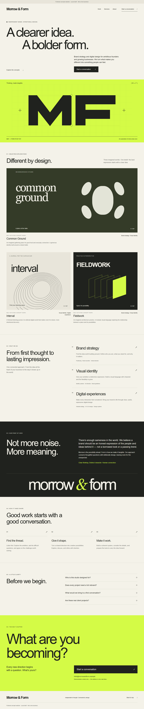

# Example: a creative-agency homepage

**Morrow & Form** is a fictional brand strategy and digital design studio, built
to illustrate how an agent can turn this starter into a distinct website.
The homepage combines oversized typography, original graphic artwork, and
an ivory, charcoal, and lime palette.

This example was built by **GPT-6 Astra through Hermes**, using the public starter
and a detailed creative brief. It was not generated from the repository link
alone. In an owner conversation, the agent would gather this kind of direction
through questions about the business, audience, and design preferences.

## The complete homepage

This is a full-page browser screenshot of the built homepage, from the navigation
through the footer—not a design mockup or a collection of cropped sections.
The original image is **1440 × 7056 pixels**.
[Open the full-resolution screenshot](images/morrow-and-form-homepage.png) to
inspect the details.

## What the agent was given

### A business and a purpose

- **Business:** Morrow & Form, a fictional independent creative studio.
- **Audience:** ambitious founders and growing businesses.
- **Services:** brand strategy, visual identity, and digital experiences.
- **Tone:** confident, thoughtful, precise, and human.
- **Visitor action:** start a conversation.
- **Contact:** a clearly labeled demonstration email address, not a real inbox.

The brief explicitly prohibited invented awards, testimonials, client logos,
performance figures, and credentials. The portfolio could contain self-initiated
concept projects, but each had to be labeled as such.

### Three reference websites

The references came with an explanation of what to take inspiration from:

- [COLLINS](https://www.wearecollins.com/): bold positioning, expressive typography,
  and art-directed project presentations.
- [Instrument](https://www.instrument.com/): confident hierarchy, spacious
  composition, and a digital-design sensibility.
- [Pentagram](https://www.pentagram.com/): editorial clarity and emphasis on the work.

These were references for design principles, not permission to copy.
The agent read extracted text from the sites; it did not inspect visual
screenshots of them. Their images, logos, and copy were not supplied as assets
or reused in the sample. None of these firms is affiliated with this example.

### Explicit creative direction

The supplied brief included:

> Make this look like a designed agency homepage, not the default scaffold with
> different words.

It asked for an editorial grid, oversized responsive typography, warm ivory and
near-black with one electric accent, strong whitespace, and contrasting sections.
It discouraged generic rounded cards, excessive pill-shaped elements, and
decorative gradients.

The agent was asked to create original CSS or SVG graphics instead of sourcing
stock photography. A suggested page structure covered a hero, identity graphic,
concept projects, services, studio perspective, process, FAQ, and contact section.
The agent could reshape that structure rather than preserve the default layout.

### The existing foundation

The agent received the public starter link and retrieved its instructions and
source. It kept the static Astro and Tailwind stack, locked dependencies,
reusable UI primitives, and license notices.

Business content remained in the site's data file, with theme tokens in the
stylesheet. The brief also required a phone-friendly layout, keyboard focus,
working section links, and no unnecessary client-side JavaScript, forms,
analytics, or remote embeds.

## What the agent produced

- **A typographic opening:** “A clearer idea. A bolder form.” with an offset
  desktop composition and a stacked phone layout.
- **An original identity graphic:** an oversized geometric “MF” composition on
  a lime background.
- **Three distinct concept showcases:** Common Ground, Interval, and Fieldwork,
  using original geometric and typographic artwork rather than borrowed photos.
- **A complete business narrative:** services, studio point of view, process,
  and expandable frequently asked questions.
- **A closing contact section:** a clear call to action, with the sample address
  identified as a non-working demonstration.

The result is a working static homepage, not just a screenshot. Its artwork uses
CSS and SVG, its FAQ uses native browser disclosures, and the built homepage
ships without application JavaScript or externally loaded assets.

The business and projects are fictional. The notice at the top and the concept
labels are intentional; they distinguish a design example from real client work.
This page documents the example rather than supplying it as a second selectable
theme in the starter.

## How to give your agent useful direction

You do not need to write a technical brief like this one. Start with the
[ordinary opening request](../README.md#start-here), then answer the agent's
questions. Useful inputs include:

1. What your business does and who the site should reach.
2. What visitors should do next.
3. Two or three reference sites, with what you like about each.
4. Your preferred tone and any colors, fonts, or layouts to avoid.
5. Your own approved copy and assets—or confirmation that you do not have them yet.

The starter supplies the engineering foundation; your answers supply the direction.
This is one possible interpretation, not a promise that every brief or agent will
produce the same design.
